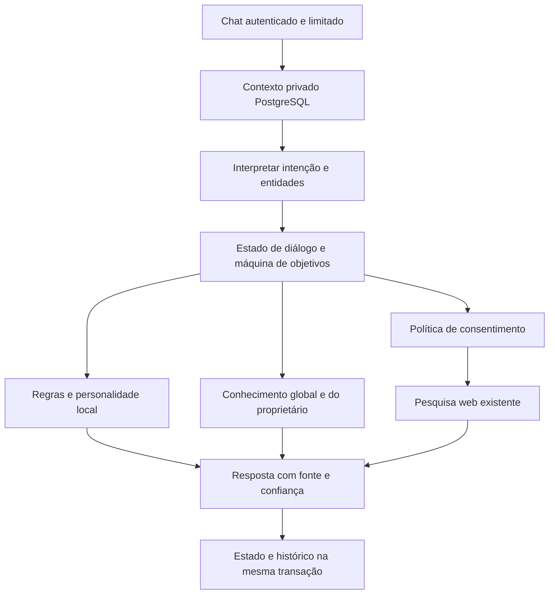

# A3X Cognitive Engine — arquitetura e relatório

Implementação local determinística em TypeScript e PostgreSQL. O nome descreve a arquitetura do aplicativo, não consciência, inteligência geral nem um modelo treinado. Nenhum modelo, API paga, download de pesos, eval ou executor de código foi adicionado.

## Pacote e revisão

A pasta solicitada `C:\projetos\A3X-Personalidade` não existia. O pacote equivalente foi localizado em `Downloads/A3X-AI-Personalidade-Executiva-v1.zip`. LEIA-ME.md, PROMPT-CODEX.txt, instalador e fontes foram lidos antes de executar. Extração foi restrita a `.tools/`, validando caminhos e tamanho. Simulação do instalador passou, sem escrita. Foram revisados os quatro arquivos novos e as três âncoras de alteração no chat; depois o instalador foi aplicado. A integração final preserva fontes, cartões, matemática e pesquisa explícita. Instruções do pacote que limitavam publicação foram substituídas pela autorização expressa do usuário para publicar esta tarefa.

Branch: `feature/a3x-cognitive-engine`, criada de `origin/main` (`73f3048`). Só este repositório foi alterado.

## Componentes

| Função | Implementação |
| --- | --- |
| Intenções e entidades | `lib/cognitive/interpret.ts`: memória, identidade, objetivo, comandos do plano, continuidade, busca e pergunta; assunto, objetivo e prazo textual |
| Memória autorizada | `cognitive_records`: fato, preferência, correção ou feedback; proposta pendente; aprovação separada; proprietário sempre da sessão |
| Estado e contexto | `cognitive_dialogue_states`: assunto, contador de turnos, plano, intenção anterior e busca aguardando consentimento, separados por conversa e usuário |
| Planejamento | Estados proposto, ativo, pausado, concluído e cancelado; só comandos explícitos avançam etapas |
| Decisão | Resposta local protegida, busca na base, pesquisa pública explicitamente solicitada ou desconhecimento; correção privada aprovada prevalece na pergunta exata |
| Continuidade | Plano persistido além das últimas 24 mensagens; cartões preservam título/contexto; perguntas de próximo passo sem timers ou ações autônomas |
| Personalidade | `config/a3x-persona.ts` e `lib/a3x-personality.ts`: identidade original de assistente executivo, sem alegar humanidade ou ações externas executadas |
| Feedback | Tela `/memoria`: propor, revisar, aprovar ou excluir. Feedback é armazenado para revisão; somente correções aprovadas com pergunta exata alteram respostas |
| Confiança | Alta, moderada ou baixa por regras, exibida na resposta. Não é probabilidade calibrada de verdade |

O histórico não é extraído para memória automaticamente. Um pedido “lembre...” orienta o usuário à tela de aprovação e não grava o fato como memória. A mensagem continua no histórico, como antes. Fatos e preferências podem ser consultados com “minha memória”; preferência `tom` aceita executivo, acolhedor ou objetivo. Não há inferência arbitrária sobre a pessoa.

## Como usar

1. Abra `/memoria`, proponha um fato ou preferência, revise o texto e confirme **Aprovar**. Pendentes não participam das respostas.
2. Para corrigir, escolha Correção e cadastre pergunta exata e resposta revisada; aprove. A correspondência normaliza caixa e acentos, sem busca semântica.
3. No Chat: `planeje estudar TypeScript até sexta`, `iniciar plano`, `ver plano`, `concluir etapa`, `pausar plano`, `retomar plano` ou `cancelar plano`.
4. `continue` retoma a etapa ativa sem concluir nada sozinho. Datas são texto informado, não lembretes agendados.
5. `pesquise ...` prepara uma busca pública. **Toda consulta** exige `confirmo envio à web` antes de qualquer envio, mesmo sem indicadores pessoais reconhecidos. A pendência vale dez minutos, uma única vez; qualquer outra mensagem a cancela.
6. O Programador solicita confirmação antes de enviar a descrição ao buscador. A API exige `confirmWeb: true`; clientes antigos precisam atualizar a página.

## Segurança e dados

Rotas de memória exigem sessão; mutações exigem origem válida; criação/aprovação exigem JSON limitado a 32 KiB. Entradas têm limites: 200 registros por usuário (incluindo pendentes), título 100, valor 4.000 e pergunta 500 caracteres. Limite de criação protegido por transação e bloqueio por usuário. Campos de proprietário/status vindos do cliente são rejeitados. Aprovação exige ação `approve` separada. Exclusão pede confirmação na interface e restringe o proprietário no SQL.

Registro de credenciais comuns é recusado por validação; isso não é um detector completo de segredos. Não cadastre senhas ou chaves. Renderização escapa conteúdo privado e não executa HTML. Nenhum dado de memória é anexado automaticamente a consultas web. A detecção de dados pessoais usa padrões e comparação textual e serve somente para um aviso adicional: pode falhar para nomes, informações indiretas ou formatos desconhecidos. Por isso, toda busca exige confirmação específica, independentemente do detector. Revise as consultas e evite dados pessoais; não há anonimização automática. Pesquisa externa continua dependendo de serviços públicos. O Programador também exige consentimento independentemente do conteúdo.

Memória e histórico são armazenados no PostgreSQL existente, sem criptografia adicional por campo. Excluir um registro revoga seu uso futuro, mas não elimina respostas, projetos, backups ou mensagens anteriores. Uma requisição já iniciada pode ter carregado a versão anterior. Excluir uma conversa remove seu estado por cascade; memórias aprovadas da conta são independentes. Não há exportação automática, envio a terceiros, voz ou ações de sistema operacional pelo motor.

## Migração e verificação

`sql/006_cognitive_engine.sql` cria duas tabelas e índices sem modificar migrações anteriores. Health exige as novas tabelas. Testes usam somente PGlite descartável, inclusive migração repetida, preservação dos 113 conhecimentos e cascade. A migração de produção ocorre exclusivamente pelo migrador normal do deploy autorizado; nenhum teste aponta para o banco real.

Os testes incluem personalidade, memória pendente/aprovada, origem inválida, proprietário forjado, isolamento entre dois usuários, cota, confirmação/expiração de pesquisa pessoal, plano em conversa de 160 turnos, persistência de 80 turnos, aprovação cancelada na interface e regressões de Chat, login, histórico e Programador. Executar `npm test`, `npm run typecheck`, `npm run build` e `git diff --check`. Resultados finais e deploy são informados na entrega.

## Limitações reais

- Interpretação lexical com comandos definidos; não compreende linguagem arbitrária, ironia ou entidades gerais. Confiança é heurística e pode estar errada.
- Planejador propõe sempre três etapas genéricas; não decompõe sistemas complexos, agenda tarefas ou executa o plano. Conclusão é apenas a declaração do usuário.
- Memória não aprende sozinha nem altera fatos por inferência. Preferências livres são consultáveis; somente o campo `tom` tem efeito automático definido.
- Correções exigem correspondência textual; feedback não treina algoritmo. Não há embeddings, inferência generativa ou iniciativa fora da conversa.
- Conhecimento e resultados web podem ser incompletos ou desatualizados. Não são sínteses produzidas por IA. As fontes cadastradas não são automaticamente verificadas.
- Programador continua um template estático com referências, sem geração arbitrária ou execução de código.
- PGlite verifica SQL e isolamento lógico; não substitui teste operacional de TLS, backups, permissões e carga do PostgreSQL Railway. Validação pública após deploy não comprova operações autenticadas com credenciais reais.

Validação local da entrega: 92 testes aprovados, typecheck sem erros e build de produção aprovado nas rodadas de integração; a última revisão passa novamente pelos mesmos comandos antes de publicação. O CI do PR repete todos os três comandos. Migração 006 repetida em banco descartável sem apagar conhecimento anterior. Nenhuma migração anterior foi editada.
