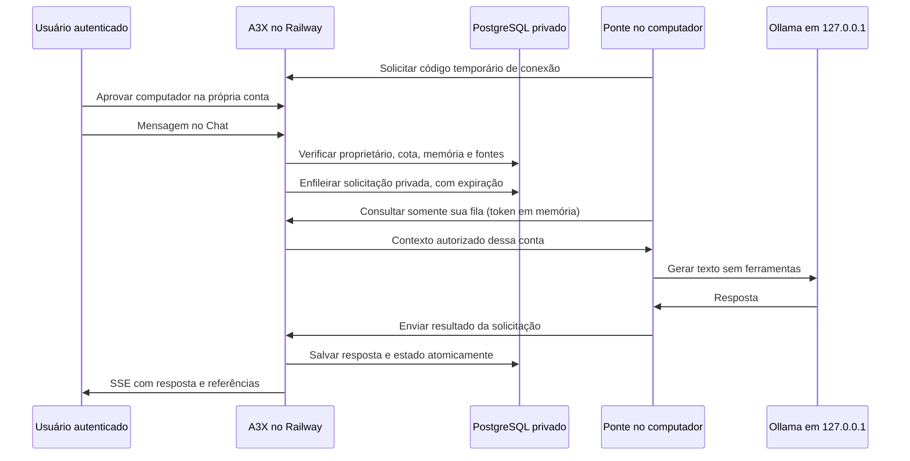

# Conversa generativa local e pesquisa múltipla

## Causa e alteração

O A3X anterior respondia por regras, cartões e recuperação textual. Isso não permite conversar livremente em assuntos novos. O usuário autorizou um modelo aberto em sua própria máquina. A integração usa Ollama com `qwen3:4b-instruct` (Qwen3 4B Instruct, quantização Q4_K_M, pesos de aproximadamente 2,5 GB e licença Apache 2.0). Não copia o ChatGPT nem treina um novo modelo.

A variante inicial `qwen3:4b` foi rejeitada no teste de conversa: seu template iniciava um bloco de raciocínio e consumia a resposta antes de produzir texto público. A variante Instruct foi escolhida para conversa direta. Marcadores internos são removidos e blocos incompletos recusados; nunca são tratados como ações executáveis. Tempos e resultado do teste real são informados na entrega. Fontes oficiais: [modelo](https://ollama.com/library/qwen3:4b-instruct), [API de chat](https://docs.ollama.com/api/chat), [Windows](https://docs.ollama.com/windows), [recursos locais/nuvem](https://docs.ollama.com/faq).

O teste real sintético está em [evidencia-modelo-local.json](evidencia-modelo-local.json): três turnos em português, planejamento das tarefas informadas e recuperação correta das duas tarefas no último turno. Não é um benchmark geral nem prova de inteligência humana. Tempos dependem de carga, cache e máquina.

## Arquitetura



Não há porta do computador exposta à internet, túnel de terceiros ou URL arbitrária de inferência. O Railway não tenta acessar o localhost do computador. A ponte inicia todas as conexões de saída. Não há chave OpenAI. O processo do computador só chama a URL HTTPS do A3X configurada e o Ollama em loopback.

## Instalação e conexão

Na máquina Windows autorizada desta tarefa, os arquivos portáteis ficam em `.tools/ollama/`, os pesos em `.tools/ollama/models/` e o Node portátil em `.tools/node-v22.23.4-win-x64/`, fora do Git. Foram obtidos apenas componentes de CPU da distribuição oficial por intervalos HTTPS; CRC do ZIP foi validado e a assinatura Authenticode do `ollama.exe` foi verificada como válida para Ollama Inc. Não foi verificado o SHA-256 do ZIP completo, pois bibliotecas CUDA desnecessárias não foram baixadas. O Ollama verifica os blobs durante o download dos pesos.

```powershell
# Se Ollama/modelo e dependências já estiverem instalados neste projeto:
& .\scripts\iniciar-modelo-local.ps1
# Consulte o link público de autorização:
Get-Content .tools/model-worker.log
```

Alternativa com Ollama instalado normalmente: execute o runtime em localhost, baixe `ollama pull qwen3:4b-instruct` e rode `npm run model:connect`. O script portátil usa o diretório de pesos do projeto e `OLLAMA_NO_CLOUD=1`, um modelo carregado, uma inferência por vez e contexto de 4.096 tokens. Se uma instância Ollama já estiver rodando, ela é reutilizada; confira sua configuração local antes de usar. Não abrimos firewall. O início automático no login do Windows pode ser instalado explicitamente com `powershell -File scripts/instalar-inicio-automatico.ps1`; usa somente a chave Run do usuário atual e o supervisor local.

Abra o endereço `/conectar?code=...` exibido pelo processo, entre na sua conta, confira o código e marque a autorização. O código sozinho não dá acesso: aprovação exige sessão e origem válidas. A máquina pode receber mensagens, contexto recente, memórias aprovadas e referências privadas da conta, conforme a autorização exibida. Não aprove códigos de terceiros. Revogue conexões antigas nessa mesma tela.

Após autorização expressa em 09/11/2026, a ponte atualizada no Windows pode guardar a credencial criptografada por DPAPI CurrentUser em `.tools/local-model-*.dpapi` (ignorado pelo Git). O valor em claro fica apenas na memória dos processos; nunca em argumentos, logs, `.env` ou banco. O servidor guarda somente o hash. Na primeira vinculação, marque **Reconectar automaticamente até eu revogar**. A ponte pode então retomar a mesma conta após reiniciar sem gerar outro código. O código inicial ainda expira em dez minutos: a ponte gera outro automaticamente até a primeira autorização. Sessão de login e consentimento continuam necessários para vincular um computador novo; um código antigo não pode autorizar uma máquina desconhecida.

A migração 009 adiciona `remembered=false`, preservando a expiração de 30 dias das conexões anteriores. Somente conexões lembradas explicitamente permanecem válidas até revogar. Há até três conexões por conta. Sem heartbeat por 30 segundos o computador aparece offline, mas isso não remove a vinculação. `LOCAL_MODEL_BRIDGE=0` desativa a ponte no servidor. `A3X_REMEMBER_COMPUTER=0` no ambiente da ponte evita persistência local; fora do Windows ela opera somente em memória. A criptografia é vinculada ao usuário Windows e não protege contra malware/administração com controle desse usuário. Trocar perfil Windows, perder a proteção DPAPI ou revogar exige uma nova primeira vinculação. O computador precisa permanecer ligado, conectado e com Ollama disponível. O cabeçalho do Chat mostra o modelo online ou o fallback.

## Conversa, conhecimento e web

Mensagens comuns usam o modelo quando disponível. Planos, consentimento, correções aprovadas, consulta explícita à memória e cálculos permanecem determinísticos. O modelo recebe somente memória aprovada do dono e referências consultadas com a sessão dessa conta; nunca recebe variáveis de ambiente, senhas do servidor ou dados de outro usuário. O contexto é reduzido a cerca de 8.000 caracteres e até 12 turnos recentes, não memória ilimitada.

Para várias buscas, escreva `pesquise TypeScript; PostgreSQL; testes automatizados`, depois `confirmo envio à web`. São no máximo três consultas solicitadas pelo usuário, com deduplicação de URLs e até 12 resultados. Perguntas que indicam informação recente oferecem pesquisa antes de uma resposta sem fontes. A consulta ainda exige confirmação; nenhuma memória privada é anexada à busca. Os provedores continuam Bing RSS/Wikipedia, sem API paga de IA e sem garantia de disponibilidade.

Quando há fontes e modelo online, ele pode sintetizar trechos. Os links reais recuperados aparecem separados da resposta; citar um ID não prova que a interpretação está correta. Não lemos arbitrariamente páginas ou executamos instruções encontradas na web. Sem resultados de pesquisa, o sistema informa a ausência e não solicita síntese de fatos atuais ao modelo. Sem computador, o retorno anterior por regras e trechos permanece disponível, com indicação de falha quando aplicável.

Markdown bloqueia imagens remotas e HTML. Links externos exigem confirmação com a URL visível, para impedir carregamentos/exfiltração automáticos de conteúdo gerado. O modelo não recebe ferramentas, shell, escrita de arquivos, credenciais ou autorização de publicação. Preferências e correções não alteram seus pesos: são contexto e recuperação, com aprovação humana.

## Limites e custos reais

- Não é consciente, ilimitado ou um substituto garantido de modelos maiores. Pode errar, inventar fatos ou não seguir instruções.
- Máquina medida: aproximadamente 15,4 GB de RAM, Core Ultra 5 135U, GPU Intel integrada. Inferência usa CPU nesta instalação. Suspender ou desligar o computador interrompe respostas generativas.
- Uma inferência por dispositivo; fila de até três solicitações por conta; saída de até 384 tokens, 12.000 caracteres máximos na validação, timeout local de 95 segundos e espera da aplicação de até 105 segundos, além do timeout global do Chat.
- O Chat não tem cota diária de perguntas. Projetos mantêm cota própria (`DAILY_PROJECT_LIMIT`, padrão 50); concorrência, tamanho e tempo de resposta continuam limitados pela infraestrutura.
- API de IA paga: nenhuma. Energia, máquina, internet, Railway, PostgreSQL e armazenamento têm custos e capacidade finita.
- A inferência não é token a token nesta versão: o transporte SSE mantém heartbeat e entrega o texto completo após validação. A resposta completa e o estado são gravados juntos.
- A fila contém contexto privado temporário no mesmo PostgreSQL do histórico; não há criptografia adicional por campo. Payload é apagado ao concluir; solicitações são removidas após consumo. Expiradas são limpas no próximo acesso da conta, não por garantia de apagamento físico no instante do relógio.
- O sistema não aprende autonomamente com qualquer site, não reescreve produção e não gera sistemas completos no Programador. O Programador existente continua preservado.

## Migração e testes

`007_local_model_bridge.sql` é incremental e cria apenas pareamentos, dispositivos e fila. Migrações anteriores e dados existentes permanecem intactos. Testes de banco são somente em PGlite descartável, incluindo reaplicação da 007, consentimento, CSRF, tokens somente como hash, reutilização de código, isolamento entre contas, conclusão da fila, revogação, cancelamento e resposta generativa no Chat. Testes também cobrem UTF-8 fragmentado, limite de contexto, respostas inválidas, bloqueio de imagens e pesquisa múltipla. Nenhuma conversa privada de produção foi usada como teste.
